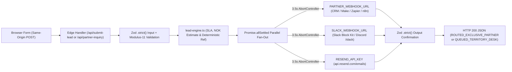

# ByggFlyt.no — Outbound Webhook & Multi-Channel Dispatch Setup

This guide documents the architecture, channel configuration, CLI secret provisioning, and exact JSON contracts for ByggFlyt.no's stateless B2B lead and partner inquiry router (`functions/lib/lead-engine.ts`).

---

## 1. Stateless Multi-Channel Router Architecture

ByggFlyt.no operates a **zero-database, stateless edge dispatch architecture** designed for deterministic reliability, GDPR data minimization (zero PII stored at rest), and full runtime parity across **Cloudflare Pages Functions** (`functions/api/*.ts`) and **Vercel Edge Runtime** (`api/*.ts`).



### Core Security & Reliability Guarantees

- **Strict Dual-Boundary Validation**: Every inbound request body is validated via `.safeParse()` against `.strict()` Zod schemas (`LeadSubmissionRequestSchema`, `PartnerInquiryRequestSchema`) with deterministic 9-digit Norwegian `orgNr` Modulus-11 checksum verification. Outbound HTTP responses are likewise validated against `LeadDispatchConfirmationSchema` or `PartnerInquiryConfirmationSchema` before serialization.
- **Fault-Isolated Parallel Fan-Out (`Promise.allSettled`)**: Configured notification channels execute concurrently. A downstream failure, HTTP `5xx`, or network stall in one channel never blocks or aborts sibling channels.
- **Bounded `3.5s` Timeout per Channel**: Every outbound `fetch()` call runs inside `postJsonBounded()` with an explicit `AbortController` set to **`3500ms`** (`clearTimeout` guaranteed in `finally`). Enhetsregisteret (`data.brreg.no`) organization lookups run with a **`3800ms`** `AbortController` timeout and deterministic offline Modulus-11 fallback.
- **HTTPS-Only Transport Guard**: Webhook targets (`PARTNER_WEBHOOK_URL` and `SLACK_WEBHOOK_URL`) are strictly ignored unless the configured URL begins with `https://`, preventing accidental plaintext dispatch or SSRF misconfiguration.
- **Graceful Zero-Channel Queue Mode**: If zero channels are configured—or if all configured upstream endpoints time out—`handleLeadSubmission` returns HTTP `200` with `status: "QUEUED_TERRITORY_DESK"` and `deliveryChannels: ["TERRITORY_QUEUE"]`, ensuring B2B conversion flows never break during staging or upstream outages.

### Environment Variables Matrix

| Variable | Required | Channel Enum | Purpose |
| :--- | :--- | :--- | :--- |
| `PARTNER_WEBHOOK_URL` | Optional | `PARTNER_WEBHOOK` | HTTPS `POST` endpoint receiving structured JSON (`BYGGFLYT_B2B_LEAD` and `TERRITORY_LEASE_INQUIRY`). |
| `SLACK_WEBHOOK_URL` | Optional | `SLACK_WEBHOOK` | Slack Incoming Webhook URL or Discord Webhook URL suffixed with `/slack`. |
| `RESEND_API_KEY` | Optional* | `EMAIL_RESEND` | Resend HTTPS API token (`Authorization: Bearer <YOUR_RESEND_KEY>`). |
| `LEAD_NOTIFY_EMAIL` | Optional* | `EMAIL_RESEND` | Destination dispatch inbox address. *Must be set alongside `RESEND_API_KEY` to activate email delivery.* |
| `LEAD_FROM_EMAIL` | Optional | `EMAIL_RESEND` | Verified sender identity. Defaults to `ByggFlyt Dispatch <onboarding@resend.dev>` when omitted. |

---

## 2. Step-by-Step Channel Configuration

### Channel A: Slack Incoming Webhooks & Discord `/slack` Webhooks (`SLACK_WEBHOOK_URL`)

`lead-engine.ts` formats rich **Slack Block Kit** notifications containing the deterministic reference ID, company name, `orgNr`, contact phone, municipality + postal code, `selectedSkuCode` (or calculator fallback), NOK contract estimate, urgency SLA (`15` / `30` / `60` / `180` min), and technical specification summary.

#### Option 1 — Slack Workspace Incoming Webhook
1. Open [https://api.slack.com/apps](https://api.slack.com/apps) and click **Create New App** → **From scratch** (e.g., `ByggFlyt Dispatch` in your operations workspace).
2. In the left sidebar, select **Incoming Webhooks** and toggle **Activate Incoming Webhooks** to **On**.
3. Click **Add New Webhook to Workspace**, select your dispatch channel (e.g., `#byggflyt-leads`), and click **Allow**.
4. Copy the resulting URL, which follows the structure:
   ```text
   https://hooks.slack.com/services/<WORKSPACE>/<CHANNEL>/<TOKEN>
   ```
5. Store this value as `SLACK_WEBHOOK_URL` via the Vercel or Wrangler CLI commands in Section 3.

#### Option 2 — Discord Server Webhook (`/slack` Compatibility Endpoint)
Discord natively parses Slack Block Kit payloads when `/slack` is appended to a standard Discord Webhook URL:
1. In Discord, open **Server Settings** → **Integrations** → **Webhooks** → **New Webhook**.
2. Assign the target text channel, name the webhook `ByggFlyt Dispatch`, and click **Copy Webhook URL**.
3. Append `/slack` to the copied URL so it matches:
   ```text
   https://discord.com/api/webhooks/<WEBHOOK_ID>/<WEBHOOK_TOKEN>/slack
   ```
4. Store the `/slack`-suffixed URL as `SLACK_WEBHOOK_URL`. Do **not** omit `/slack`, as standard Discord webhooks expect a `content` root key rather than Slack `text`/`blocks`.

---

### Channel B: Transactional Email via Resend (`RESEND_API_KEY`, `LEAD_NOTIFY_EMAIL`, `LEAD_FROM_EMAIL`)

ByggFlyt.no dispatches plain-text operational emails directly over HTTPS (`POST https://api.resend.com/emails`) with zero Node.js SMTP dependencies, full Edge compatibility, and CR/LF header sanitization on user-supplied company names.

1. Sign in to [https://resend.com](https://resend.com), open **Domains** → **Add Domain**, and add your verified dispatch domain (e.g., `byggflyt.no` or `varsel.byggflyt.no`).
2. Publish the **DKIM** (`TXT`), **SPF** (`MX` + `TXT`), and **DMARC** DNS records in Cloudflare DNS and click **Verify DNS Records**.
3. Navigate to **API Keys** → **Create API Key**:
   - **Name**: `byggflyt-edge-dispatch`
   - **Permission**: `Sending access` (restricted to your verified domain)
   - Copy the key placeholder (`<YOUR_RESEND_KEY>`).
4. Configure the three email environment variables:
   - `RESEND_API_KEY`: `<YOUR_RESEND_KEY>`
   - `LEAD_NOTIFY_EMAIL`: `dispatch@byggflyt.no` (the recipient inbox receiving lead & partner alerts)
   - `LEAD_FROM_EMAIL`: `ByggFlyt Dispatch <varsel@byggflyt.no>` (must match your verified Resend domain; if omitted in sandbox testing, defaults to `ByggFlyt Dispatch <onboarding@resend.dev>`, which can only deliver to your own Resend account email).

> **Note:** Both `RESEND_API_KEY` and `LEAD_NOTIFY_EMAIL` must be non-empty for the `EMAIL_RESEND` task to be scheduled.

---

### Channel C: Partner / CRM / Make / Zapier / n8n Webhook (`PARTNER_WEBHOOK_URL`)

`PARTNER_WEBHOOK_URL` sends a raw JSON `POST` (`Content-Type: application/json`) for automated routing into **Make.com**, **Zapier**, **n8n**, **HubSpot**, **Pipedrive**, or a regional equipment partner's depot API.

1. Create an HTTPS `POST` webhook trigger in your automation platform:
   - **Make.com**: Create a scenario → add **Webhooks → Custom webhook** → copy the `https://hook.eu2.make.com/<WEBHOOK_PATH>` URL.
   - **Zapier**: Create a Zap → **Webhooks by Zapier** → Event: **Catch Hook** → copy the `https://hooks.zapier.com/hooks/catch/<ACCOUNT_ID>/<HOOK_ID>/` URL.
   - **n8n**: Add a **Webhook** node → HTTP Method: `POST`, Respond: `Immediately` (`200 OK`) → copy the Production URL (`https://<YOUR_N8N_HOST>/webhook/<WEBHOOK_UUID>`).
2. Ensure your receiving endpoint responds with an HTTP `2xx` status within **`3500ms`**. Perform heavy downstream CRM mutations asynchronously after acknowledging receipt.
3. Add a router/filter branch in your workflow inspecting the root `type` discriminator:
   - `type === "BYGGFLYT_B2B_LEAD"` → Route by `territorySlotKey` (e.g., `oslo__maskinutleie` or `oslo__byggestrom-og-utslippsfri-rigg`), prioritize by `responseSlaMinutes`, and inspect `selectedSkuCode` when an exact catalog machine (such as a beltegraver, strømaggregat, batteribank, or varmluftsaggregat) was chosen.
   - `type === "TERRITORY_LEASE_INQUIRY"` → Route to ByggFlyt's internal commercial desk / CRM pipeline for Rank-and-Rent territory onboarding.

---

## 3. CLI Secret Provisioning Commands

Never commit real credentials or webhook URLs to `.env` or source files (`ci-gate.yml` enforces Gitleaks across full git history). Provision secrets exclusively via platform CLIs.

### Vercel Edge Deployment (`npx vercel env add`)

Run each command from the repository root and paste the secret value when prompted (repeat for `preview` if staging dispatch is desired):

```bash
npx vercel env add PARTNER_WEBHOOK_URL production
npx vercel env add SLACK_WEBHOOK_URL production
npx vercel env add RESEND_API_KEY production
npx vercel env add LEAD_NOTIFY_EMAIL production
npx vercel env add LEAD_FROM_EMAIL production
```

Trigger a production deployment so Edge Functions pick up the updated environment bindings:

```bash
npx vercel --prod
```

### Cloudflare Pages Deployment (`npx wrangler pages secret put`)

Run each command from the repository root and paste the secret value at the interactive prompt:

```bash
npx wrangler pages secret put PARTNER_WEBHOOK_URL --project-name byggflyt-no
npx wrangler pages secret put SLACK_WEBHOOK_URL --project-name byggflyt-no
npx wrangler pages secret put RESEND_API_KEY --project-name byggflyt-no
npx wrangler pages secret put LEAD_NOTIFY_EMAIL --project-name byggflyt-no
npx wrangler pages secret put LEAD_FROM_EMAIL --project-name byggflyt-no
```

For local Wrangler development, copy `.env.example` to `.dev.vars` (which is gitignored) and populate test endpoints locally.

---

## 4. Sample Outbound JSON Payloads (`PARTNER_WEBHOOK_URL`)

### 4.1 B2B Equipment Lead (`BYGGFLYT_B2B_LEAD`)

Emitted by `POST /api/submit-lead` when a verified Norwegian enterprise submits an equipment request (including optional `selectedSkuCode` and `calculatorSnapshot`):

```json
{
  "type": "BYGGFLYT_B2B_LEAD",
  "leadReferenceId": "BF-261028-4K9M",
  "territorySlotKey": "oslo__maskinutleie",
  "selectedSkuCode": "SKU-GRAV-085T-EL",
  "request": {
    "orgNr": "912345688",
    "companyName": "Østlandske Entreprenør AS",
    "contactName": "Henrik Solberg",
    "phone": "+4791234567",
    "municipalitySlug": "oslo",
    "categorySlug": "maskinutleie",
    "postalCode": "0579",
    "durationDays": 10,
    "urgency": "IMORGEN_0700",
    "selectedSkuCode": "SKU-GRAV-085T-EL",
    "rawNeedDescription": "Trenger batterielektrisk 8,5t beltegraver med tiltrotator og pusseskuffe til VA-grøft på Helsfyr. Portbredde 280 cm, levering kl. 07:00.",
    "calculatorSnapshot": {
      "calculatorType": "maskinutleie",
      "headlineSpec": "8–9t batterielektrisk korthekker + 250 kg reversibel vibroplate",
      "estimatedValueNokMin": 32100,
      "estimatedValueNokMax": 48280,
      "complianceSummary": "Maskinførerbevis M2 påkrevd (>15 kW). Bestill kabelpåvisning / gravemelding før oppstart."
    }
  },
  "recommendedSpecSummary": "[SKU-GRAV-085T-EL] 8–9t batterielektrisk korthekker + 250 kg reversibel vibroplate",
  "estimatedContractNokMin": 32100,
  "estimatedContractNokMax": 48280,
  "responseSlaMinutes": 30
}
```

**Urgency-to-SLA Mapping (`responseSlaMinutes`):**
- `AKUTT_IDAG` → `15` minutes
- `IMORGEN_0700` → `30` minutes
- `DENNE_UKEN` → `60` minutes
- `PLANLAGT_ANBUD` → `180` minutes

*Note: When the user submits via calculator/free-text without selecting a specific catalog SKU, `selectedSkuCode` is `undefined` (omitted during `JSON.stringify`).*

---

### 4.2 Exclusive Territory Partner Inquiry (`TERRITORY_LEASE_INQUIRY`)

Emitted by `POST /api/partner-inquiry` when a regional rental depot applies to lease an exclusive municipality × category Rank-and-Rent slot:

```json
{
  "type": "TERRITORY_LEASE_INQUIRY",
  "applicationId": "PARTNER-261028-7P2X",
  "slotKey": "lillestrom-lorenskog__vintervarme-og-teletining",
  "monthlyLeaseNok": 11500,
  "applicant": {
    "orgNr": "987654325",
    "companyName": "Romerike Maskin & Varmeutleie AS",
    "contactName": "Marte Lindqvist",
    "email": "post@romerike-utleie.example",
    "phone": "+4798765432",
    "desiredMunicipality": "lillestrom-lorenskog",
    "desiredCategory": "vintervarme-og-teletining",
    "depotLocation": "Hvamveien, 2013 Skjetten",
    "fleetSummary": "14 væskebårne teletinere (45–110 kW), 80 isolasjonsmatter, indirekte varmluftsaggregat (65–150 kW) og 24/7 vakttelefon på Romerike."
  }
}
```
